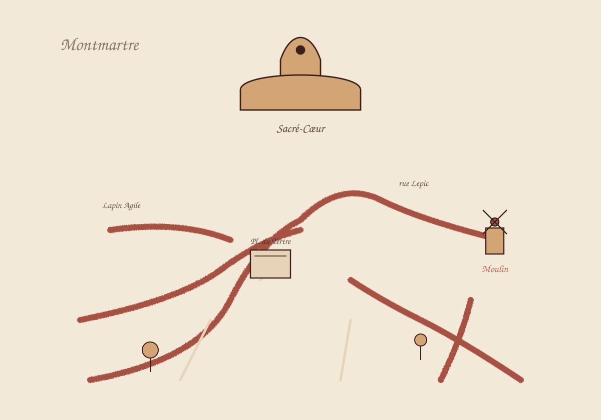

<div align="center">

# 城市大师漫游 · City Walking Master

<a id="english"></a>
**Wander through six painted neighborhoods and their cultural stories.**

**English** · [简体中文](README.md)

[](#在-cursor-canvas-中打开)

[Explore](#从一次散步开始) · [Neighborhoods](#六座城市六种笔触) · [Open the prototype](#在-cursor-canvas-中打开) · [Controls](#操作速查) · [Implementation and limits](#实现与边界)

</div>



This image is exported directly from the source's ParisMap and Paris palette, retaining its paths and labels. It previews the map artwork, not the complete application, and is not a geographic navigation map.

<a id="从一次散步开始"></a>
## Start with a walk

City Walking Master is an interactive **Cursor Canvas prototype**. Each neighborhood has its own SVG artwork, colors, historical-event markers, and character portraits. Move across the map, approach a story, and open a character panel to explore further.

1. Choose a city, from Montmartre's ochre streets to Bloomsbury's blue-gray squares.
2. Move by keyboard or by clicking the map. Select event markers to read local stories and find related characters.
3. Try a conversation using a suggested question or your own text.
4. Use the guided-tour mode, or enable the ambient sound synthesized with Web Audio.

**Dialogue uses locally written answers and templates, not an LLM.** Character lines are creative interpretations, not authentic quotations, the historical person's actual opinions, or a reliable historical question-answering service.

<a id="六座城市六种笔触"></a>
## Six neighborhood views

| City | Neighborhood | Cultural threads |
| --- | --- | --- |
| Paris | Montmartre | Studios, windmills, painters, and poets |
| New York | Greenwich Village | Literature, music, and neighborhood life |
| London | Bloomsbury | Squares, writers, and intellectual life |
| Tokyo | Asakusa | Temples, Edo memories, and the modern city |
| Vienna | Innere Stadt | Cafés, music, and Viennese modernism |
| Hong Kong | Central / Sheung Wan / Tsim Sha Tsui | The harbor, cinema, literature, and urban memory |

These are artistic cultural views, not scale street reconstructions. The juxtaposition of people, places, and periods is part of the curatorial and interaction design.

<a id="在-cursor-canvas-中打开"></a>
## Open in Cursor Canvas

You need a Cursor Canvas environment that supports the `cursor/canvas` SDK. **This repository has no standalone web build configuration; `npm run dev` is not supported.**

```bash
git clone https://github.com/yuzhang-zhong/city-walking-master.git
```

1. Open the cloned repository in Cursor.
2. Open [`canvases/city-walking-master.canvas.tsx`](canvases/city-walking-master.canvas.tsx).
3. Run its Canvas preview. If your Cursor version has no Canvas support, a regular browser or React project is not a direct replacement for the host.

<a id="操作速查"></a>
### Controls

| Action | Input |
| --- | --- |
| Move | Arrow keys / WASD, or click the map |
| Take a larger step | Hold Shift while using a movement key |
| Open a location story | Click an event marker or approach its location |
| Close the character panel | Esc or the panel's close control |
| Converse | Choose a suggested question or type into the input |
| Ambient sound / guided tour | Use the corresponding map controls |

Movement shortcuts do not intercept typing while an input is focused. Audio requires Web Audio support in the host browser and must be enabled by the user.

<a id="实现与边界"></a>
## Implementation and limits

- The prototype is a single Canvas TSX file containing maps, portraits, palettes, events, and interaction logic.
- The prototype code makes no external network requests and needs no model API key. This does not describe the Cursor host's own network behavior.
- Suggested questions have prewritten answers; free text is combined with character templates. There is no fact retrieval or semantic reasoning.
- Web Audio oscillators synthesize the ambient sound; the prototype does not download audio tracks.
- Historical descriptions and dramatized dialogue have not been systematically verified. Check original sources before quoting them or using them for research.
- This is not a travel tool. It provides no live traffic, route planning, opening hours, or travel-safety assessment.

<a id="从哪里改起"></a>
## Where to make changes

Search the [Canvas source](canvases/city-walking-master.canvas.tsx) for:

| Goal | Entry points |
| --- | --- |
| Maps and colors | Map components such as `ParisMap`, and `PALETTE_*` |
| Characters and preset dialogue | `CELEBS_*`, `suggestions`, `makeVoice` |
| Location events | `EVENTS_*` |
| Another city | `CityId`, `CITIES`, and the corresponding map / data |
| Walking and guided tours | `CityWalkingMaster`, `moveWalkerTo`, and tour logic |

Keep new character lines clearly framed as creative interpretations; do not present them as authentic quotations. Verify interaction changes inside Cursor Canvas.

<a id="许可"></a>
## License

MIT
