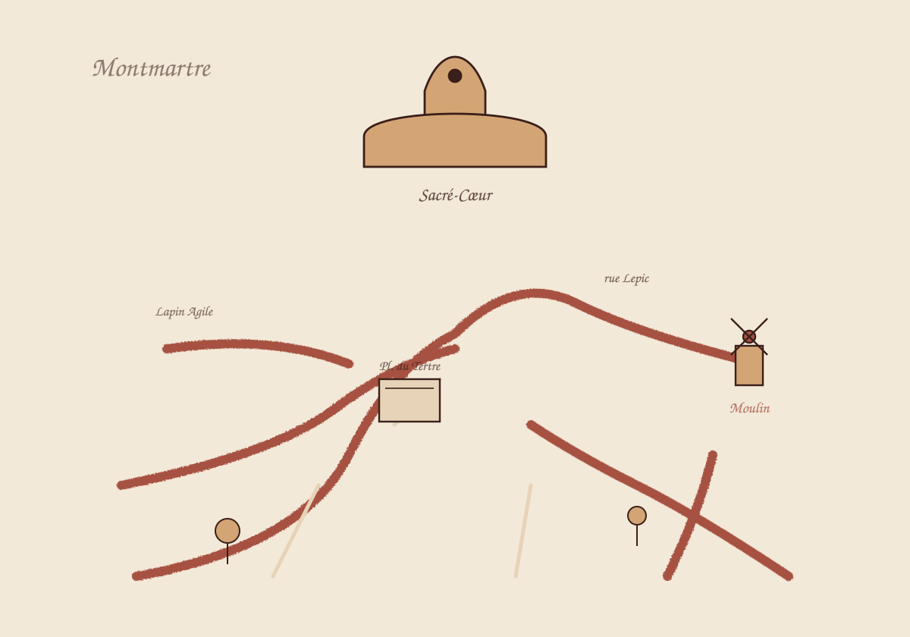

<h1 align="center">城市大师漫游 · City Walking Master</h1>
<p align="center"><strong>把街区当作画布，把散步当作阅读。</strong><br>Six painted neighborhoods. A small, scripted atlas of cultural encounters.</p>
<p align="center"><a href="#从一次散步开始">探索方式</a> · <a href="#在-cursor-canvas-中打开">运行</a> · <a href="#实现与边界">实现与边界</a> · <a href="#english">English</a></p>



<sub>上图直接导出自源码中的 ParisMap 与巴黎配色，保留原有路径和文字。它是地图画作预览，不是完整应用截图，也不是地理导航地图。</sub>

## 从一次散步开始

城市大师漫游是一个 **Cursor Canvas 交互原型**。每个街区有自己的 SVG 画作、色彩、历史事件标记和人物肖像：在地图里移动，走近一段故事，再打开人物面板继续探索。

1. **选一座城市。** 从蒙马特的赭红色街巷切换到布鲁姆斯伯里的灰蓝色广场。
2. **沿着地图走。** 点击地图或用键盘移动；点选事件标记，查看地点故事与关联人物。
3. **停下来交谈。** 选择预设问题，或输入一句话体验人物风格的脚本回复。
4. **换一种节奏。** 使用导览模式，或按需开启由 Web Audio 合成的氛围音。

**对话是本地编写的问答与模板，不调用 LLM。** 人物台词是创作性演绎，不是真实引文、历史人物的真实意见或可靠史料问答。

## 六座城市，六种笔触

| 城市 | 街区视角 | 内容线索 |
| --- | --- | --- |
| Paris · 巴黎 | Montmartre · 蒙马特 | 画室、风车、画家与诗人 |
| New York · 纽约 | Greenwich Village · 格林威治村 | 文学、音乐与街区文化 |
| London · 伦敦 | Bloomsbury · 布鲁姆斯伯里 | 广场、作家与思想生活 |
| Tokyo · 东京 | Asakusa · 浅草 | 寺庙、江户记忆与现代城市 |
| Vienna · 维也纳 | Innere Stadt · 内城 | 咖啡馆、音乐与维也纳现代主义 |
| Hong Kong · 香港 | Central / Sheung Wan / Tsim Sha Tsui · 中环、上环、尖沙咀 | 海港、电影、文学与城市记忆 |

这些是艺术化的文化切片，不是按比例复原的街道图。人物、地点与年代的并置是策展与交互设计的一部分。

## 在 Cursor Canvas 中打开

需要支持 `cursor/canvas` SDK 的 Cursor Canvas 环境。**本仓库没有独立网页构建配置，不支持直接运行 `npm run dev`。**

```bash
git clone https://github.com/yuzhang-zhong/city-walking-master.git
```

1. 在 Cursor 中打开克隆后的仓库。
2. 打开 [`canvases/city-walking-master.canvas.tsx`](canvases/city-walking-master.canvas.tsx)。
3. 使用该环境的 Canvas 预览运行交互。若当前 Cursor 版本没有 Canvas，普通浏览器或普通 React 项目不能直接替代这个宿主。

### 操作速查

| 操作 | 输入 |
| --- | --- |
| 移动 | 方向键 / WASD，或点击地图 |
| 大步移动 | 按住 Shift 再使用移动键 |
| 进入地点故事 | 点击事件标记，或走近事件地点 |
| 关闭人物面板 | Esc，或面板内的关闭操作 |
| 对话 | 选择预设问题，或在输入框中输入 |
| 氛围音 / 导览 | 使用地图上的相应控制按钮 |

输入框获得焦点时，移动快捷键不会接管打字。音频需要宿主浏览器支持 Web Audio，且由用户开启。

## 实现与边界

- **单文件原型。** 地图、肖像、城市配色、事件数据和交互都在同一份 Canvas TSX 中。
- **本地内容。** 原型代码没有外部网络请求，不需要模型 API key；这不代表 Cursor 宿主本身的网络行为。
- **脚本式人物声音。** 预设问题对应已写好的答案；自由输入通过人物模板组合回复，不做事实检索或语义推理。
- **合成声音。** Web Audio 振荡器构造氛围音，不下载音轨。
- **历史内容待核验。** 地点说明和演绎台词不应当作经过系统校勘的历史数据库。引用与研究请另查原始来源。
- **不是出行工具。** 不提供实时路况、路线规划、开放时间或出行安全判断。

## 从哪里改起

在 [Canvas 源文件](canvases/city-walking-master.canvas.tsx)中搜索以下标识：

| 目标 | 入口 |
| --- | --- |
| 改地图与颜色 | `ParisMap` 等地图组件、`PALETTE_*` |
| 改人物与预设问答 | `CELEBS_*`、`suggestions`、`makeVoice` |
| 改地点事件 | `EVENTS_*` |
| 增加城市 | `CityId`、`CITIES` 及对应地图 / 数据 |
| 调整走路与导览 | `CityWalkingMaster`、`moveWalkerTo`、导览逻辑 |

修改人物台词时，请保持“创作性演绎”边界，不把新写的句子冒充真实引文。修改后的交互需要在 Cursor Canvas 内验证。

## English

City Walking Master is an artistic neighborhood-exploration prototype for **Cursor Canvas**, not a standalone web app. Explore six embedded SVG maps, move with arrows/WASD or clicks, open local event markers, and try character encounters with prewritten answers and templated responses. No LLM or external API is called by the prototype code.

The preview above is a static export of the repository's original Montmartre SVG, not a runtime screenshot. Maps are interpretive, not navigational; character dialogue is fictionalized and historical claims need independent verification. Open the TSX file in a compatible Cursor Canvas environment to use the full experience.

## 许可

MIT
